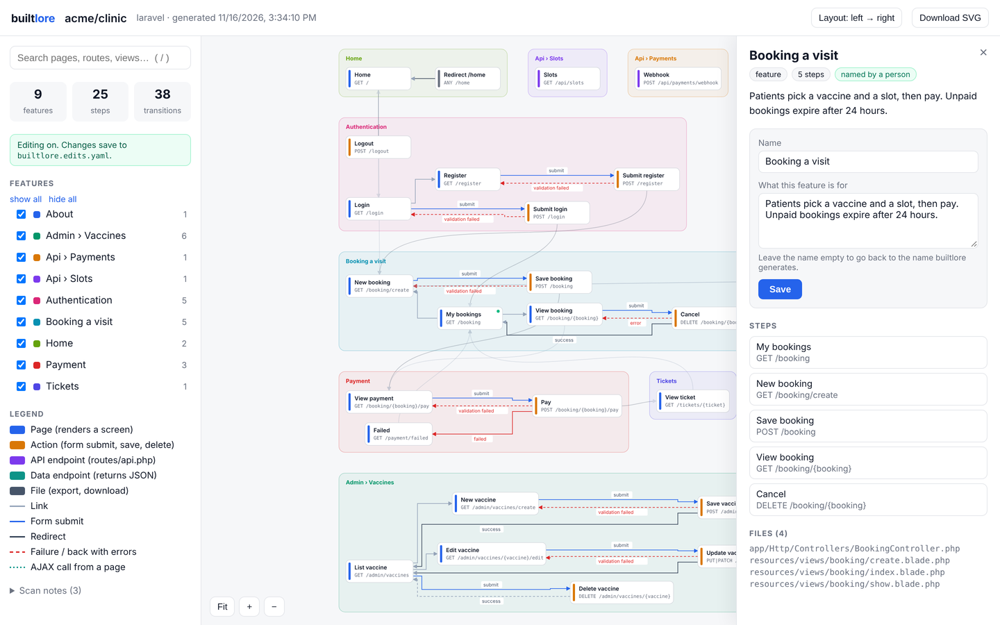

# builtlore

*The lore of what you built.*

**See how your app is actually built.** builtlore reads your code and draws its business flows on one interactive canvas: every page, every form, every redirect, and every failure branch, with links back to the exact file and line.


> **Status: early alpha (v0.1).** Laravel is supported today. Go, Next.js and Flutter are next. See the [design document](docs/DESIGN.md) for the full plan.

## Why

AI writes code faster than teams can understand it. Requirements arrive through chat, documentation is thin, and the real business process lives in people's heads. Text docs don't fix that, because nobody reads them.

builtlore generates a map of the system **as it is built**, straight from the code, so developers, product people and AI agents can all see the same picture. It stays accurate because it is regenerated, not hand-maintained.

## What you get

- **Business flows, not call graphs.** Pages, form submissions and redirects become steps and arrows, grouped into features.
- **Failure branches.** Validation errors, `withErrors()`, `with('error')` and `back()` show up as red dashed arrows, so you can see what happens when things go wrong.
- **Click through to code.** Every step shows its route, handler, view, middleware and the file and line that defines it.
- **One offline HTML file.** No server, no account, no network. Open it, share it, or attach it to a ticket.
- **A JSON model you can commit.** `builtlore.json` is a stable, diff-friendly description of your app's flows.
- **No guessing.** Anything builtlore can't resolve is listed under *Skipped*, never invented.


## Quick start

builtlore is not on npm yet. Run it from source (Node.js 20 or newer):

```bash
git clone https://github.com/<your-account>/builtlore.git
cd builtlore
npm install
npm run build
npm link            # makes the `builtlore` command available everywhere
```

Then, in any Laravel project:

```bash
cd path/to/your-laravel-app
builtlore scan --open
```

Once published, this becomes `npx builtlore scan --open`.

## Usage

```bash
builtlore scan                              # scan the current folder
builtlore scan ~/work/project-1 ~/work/project-2   # scan several projects, each gets its own map
builtlore view ~/work/project-1             # re-open the canvas for a scanned project
builtlore serve                             # open the canvas with editing on (see below)
builtlore init                              # write builtlore.config.yaml and ignore .builtlore/
```

| Option | Meaning |
|---|---|
| `--mode auto` | Default. Use artisan if available, otherwise static parsing. |
| `--mode artisan` | Ask Laravel for the exact route table (`php artisan route:list`). Needs PHP and `vendor/`. |
| `--mode static` | Parse route files directly. Works without PHP. |
| `--out <file>` | Where to write the JSON model (default `builtlore.json`). |
| `--open` | Open the canvas after scanning. |
| `--php <path>` | PHP executable for artisan mode, e.g. Laragon or XAMPP `php.exe` (or set `BUILTLORE_PHP`). |

Each scan writes two files into the project:

- `builtlore.json`: the as-built model. Commit it to track how your app's flows change over time.
- `.builtlore/map.html`: the canvas. Generated, so `builtlore init` adds `.builtlore/` to `.gitignore`.

### Reading the canvas

| On the canvas | Means |
|---|---|
| Blue bar | Page: a GET route that renders a screen |
| Orange bar | Action: a form submission (POST, PUT, PATCH, DELETE) |
| Purple bar | API endpoint |
| Grey arrow | Link (`<a href>`) |
| Blue arrow | Form submit (`<form action>`, including `@method()` spoofing) |
| Dark arrow | Redirect from the handler |
| Teal bar | Data endpoint: returns JSON (AJAX, DataTables, dropdown data). Hidden by default |
| Slate bar | File: export or download (Excel, PDF, `response()->download()`). Hidden by default |
| Red dashed arrow | Failure branch: validation failed, `withErrors()`, `with('error')` |
| Teal dotted arrow | AJAX call from a page (`$.post`, `fetch`, DataTables `ajax:`) |

Shortcuts: `/` search, `f` fit to screen, `Esc` clear selection. Scroll to zoom, drag to pan. Use **only** next to a feature to focus on it. Tick **Show data & file endpoints** to see the AJAX and export endpoints behind each page.

Large apps: route name prefixes that act as menus or areas (`menu.*`, `master.*`, `admin.*`) are split into one feature per controller domain, so `MTDIController` and `StatusMTDIController` end up in the same feature.

### Editing: names, descriptions, grouping

Code tells builtlore *what* exists; only people know *why*. Run:

```bash
builtlore serve            # scans, then opens http://127.0.0.1:4321 with editing on
```



Click a step or a feature title and edit it: give it a business name, write what happens there, move it to another feature (or type a new feature name), or hide it. Every save goes to **`builtlore.edits.yaml`** in your project:

```yaml
features:
  menu.mtdi:
    name: Monthly target input (MTDI)
    description: Area managers enter monthly targets; the regional head approves them.
steps:
  route:menu.mtdi.status.approve:
    label: Regional head approves
    description: Locks the targets for the month. Rejected targets go back to the area manager.
    code: 4f1c2a9be0
glossary:
  MTDI: Month-to-date input
```

- **Commit this file.** Rescans start from the code and apply the edits on top, so nothing you write is overwritten.
- You can edit the file by hand too; comments are kept.
- When the code behind a described step changes, the step gets an **amber dot** and a "check the description" note, rather than silently showing something outdated. Saving it again clears the flag.
- Edits for steps that no longer exist are kept and listed in the scan notes, so you can decide what to do with them.

`serve` only listens on `127.0.0.1`, and writes need a per-session token, so other websites open in your browser cannot change your files.

## What builtlore reads in a Laravel app

| Source | What it extracts |
|---|---|
| `routes/web.php`, `routes/api.php` and files they `require` | Routes, including `prefix`, `name`/`as`, `middleware`, `controller()` groups, array-style `group()`, `resource`/`apiResource` with `only`/`except`, `Route::view`, `Route::redirect`, `match`, `any` |
| Controllers (via `composer.json` PSR-4) | Rendered views (`view()`, `View::make`, `Inertia::render`), redirects (`redirect()->route()`, `to_route()`, `back()`, `redirect('/path')`, `intended()`, `action()`), validation (`$request->validate()`, Form Request parameters) |
| Route closures | Same as controllers |
| Blade views and `@include`d partials | Links and forms pointing at `route()`, `url()`, `action()` or literal paths |
| Scripts and attributes in Blade (`$.post("{{ route('x') }}")`, DataTables `ajax:`, `data-url="{{ route('x') }}"`) | AJAX calls and links built in JavaScript |
| Layouts (`@extends`, `<x-app-layout>`) | Counted but not drawn, so navigation menus do not connect every page to every other page |
| The route table as a whole | Warnings for duplicate routes (same method and URI defined twice) and route names used by more than one route |

Inertia and Livewire pages are detected; following their navigation is planned.

## Privacy

builtlore v0.1 runs entirely on your machine. It does not use AI and makes no network calls (`builtlore serve` listens on `127.0.0.1` only). It reads code only: it never reads `.env` values or connects to your database. (Optional AI naming and a read-only database layer are planned, and will be opt-in; see the design document.)

## Roadmap

| Version | Scope |
|---|---|
| **v0.1** | Laravel flows · canvas · JSON model |
| v0.2 | **Process view:** business processes as swimlanes: who does each step (roles from middleware, policies, role checks) and how the status changes (strings, numbers, constants, enums) |
| v0.3 | **Project documentation:** a full docs site generated from code + your edits: system overview, roles and permissions, processes, screens, business rules (validation), data dictionary, integrations, jobs, API reference, glossary, change history. Export to Markdown, HTML, Word/PDF |
| v0.3.x | History: when each feature appeared and how it changed (git) · timeline slider · CI check |
| v0.4 | Data layer: tables, relationships, stored procedures, step ↔ table links |
| v0.5 | Automation layer: schedulers, cron, queues, webhooks |
| v0.6 | Go, Next.js and Flutter adapters |
| v0.7 | Tests layer: which flows are covered, results on the canvas |
| v0.8 | Requirements layer: what was requested vs. what was built |

Details in [docs/DESIGN.md](docs/DESIGN.md).

## Contributing

Adapters for new frameworks are the most valuable contribution. See [CONTRIBUTING.md](CONTRIBUTING.md).

## License

[MIT](LICENSE)
