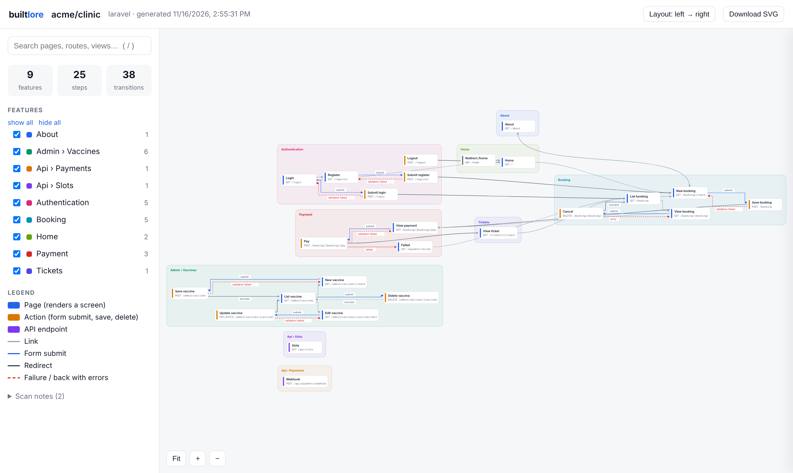
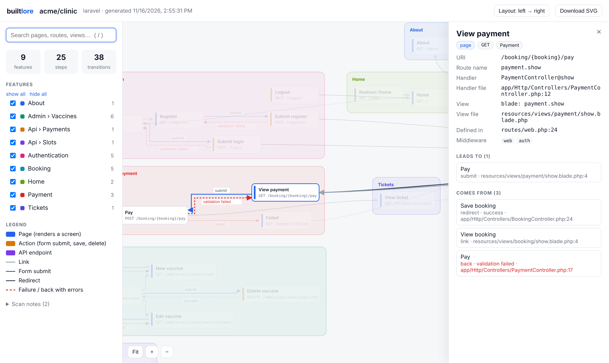

# builtlore

*The lore of what you built.*

**See how your app is actually built.** builtlore reads your code and draws its business flows on one interactive canvas: every page, every form, every redirect, and every failure branch, with links back to the exact file and line.



> **Status: early alpha (v0.1).** Laravel is supported today. Go, Next.js and Flutter are next. See the [design document](docs/DESIGN.md) for the full plan.

## Why

AI writes code faster than teams can understand it. Requirements arrive through chat, documentation is thin, and the real business process lives in people's heads. Text docs don't fix that, because nobody reads them.

builtlore generates a map of the system **as it is built**, straight from the code, so developers, product people and AI agents can all see the same picture. It stays accurate because it is regenerated, not hand-maintained.

## What you get

- **Business flows, not call graphs.** Pages, form submissions and redirects become steps and arrows, grouped into features.
- **Failure branches.** Validation errors, `withErrors()`, `with('error')` and `back()` show up as red dashed arrows, so you can see what happens when things go wrong.
- **Click through to code.** Every step shows its route, handler, view, middleware and the file and line that defines it.
- **One offline HTML file.** No server, no account, no network. Open it, share it, or attach it to a ticket.
- **A JSON model you can commit.** `builtlore.json` is a stable, diff-friendly description of your app's flows.
- **No guessing.** Anything builtlore can't resolve is listed under *Skipped*, never invented.



## Quick start

builtlore is not on npm yet. Run it from source (Node.js 20 or newer):

```bash
git clone https://github.com/<your-account>/builtlore.git
cd builtlore
npm install
npm run build
npm link            # makes the `builtlore` command available everywhere
```

Then, in any Laravel project:

```bash
cd path/to/your-laravel-app
builtlore scan --open
```

Once published, this becomes `npx builtlore scan --open`.

## Usage

```bash
builtlore scan                              # scan the current folder
builtlore scan ~/work/project-1 ~/work/project-2   # scan several projects, each gets its own map
builtlore view ~/work/project-1             # re-open the canvas for a scanned project
builtlore init                              # write builtlore.config.yaml and ignore .builtlore/
```

| Option | Meaning |
|---|---|
| `--mode auto` | Default. Use artisan if available, otherwise static parsing. |
| `--mode artisan` | Ask Laravel for the exact route table (`php artisan route:list`). Needs PHP and `vendor/`. |
| `--mode static` | Parse route files directly. Works without PHP. |
| `--out <file>` | Where to write the JSON model (default `builtlore.json`). |
| `--open` | Open the canvas after scanning. |

Each scan writes two files into the project:

- `builtlore.json`: the as-built model. Commit it to track how your app's flows change over time.
- `.builtlore/map.html`: the canvas. Generated, so `builtlore init` adds `.builtlore/` to `.gitignore`.

### Reading the canvas

| On the canvas | Means |
|---|---|
| Blue bar | Page: a GET route that renders a screen |
| Orange bar | Action: a form submission (POST, PUT, PATCH, DELETE) |
| Purple bar | API endpoint |
| Grey arrow | Link (`<a href>`) |
| Blue arrow | Form submit (`<form action>`, including `@method()` spoofing) |
| Dark arrow | Redirect from the handler |
| Red dashed arrow | Failure branch: validation failed, `withErrors()`, `with('error')` |

Shortcuts: `/` search, `f` fit to screen, `Esc` clear selection. Scroll to zoom, drag to pan. Use **only** next to a feature to focus on it.

## What builtlore reads in a Laravel app

| Source | What it extracts |
|---|---|
| `routes/web.php`, `routes/api.php` and files they `require` | Routes, including `prefix`, `name`/`as`, `middleware`, `controller()` groups, array-style `group()`, `resource`/`apiResource` with `only`/`except`, `Route::view`, `Route::redirect`, `match`, `any` |
| Controllers (via `composer.json` PSR-4) | Rendered views (`view()`, `View::make`, `Inertia::render`), redirects (`redirect()->route()`, `to_route()`, `back()`, `redirect('/path')`, `intended()`, `action()`), validation (`$request->validate()`, Form Request parameters) |
| Route closures | Same as controllers |
| Blade views and `@include`d partials | Links and forms pointing at `route()`, `url()`, `action()` or literal paths |
| Layouts (`@extends`, `<x-app-layout>`) | Counted but not drawn, so navigation menus do not connect every page to every other page |

Inertia and Livewire pages are detected; following their navigation is planned.

## Privacy

builtlore v0.1 runs entirely on your machine. It does not use AI and makes no network calls. It reads code only: it never reads `.env` values or connects to your database. (Optional AI naming and a read-only database layer are planned, and will be opt-in; see the design document.)

## Roadmap

| Version | Scope |
|---|---|
| **v0.1** | Laravel flows · canvas · JSON model |
| v0.2 | History: when each feature appeared and how it changed (git) · timeline slider |
| v0.3 | Human notes and corrections that survive re-scans · Markdown docs · CI check |
| v0.4 | Data layer: tables, relationships, stored procedures, step ↔ table links |
| v0.5 | Automation layer: schedulers, cron, queues, webhooks |
| v0.6 | Go, Next.js and Flutter adapters |
| v0.7 | Tests layer: which flows are covered, results on the canvas |
| v0.8 | Requirements layer: what was requested vs. what was built |

Details in [docs/DESIGN.md](docs/DESIGN.md).

## Contributing

Adapters for new frameworks are the most valuable contribution. See [CONTRIBUTING.md](CONTRIBUTING.md).

## License

[MIT](LICENSE)
